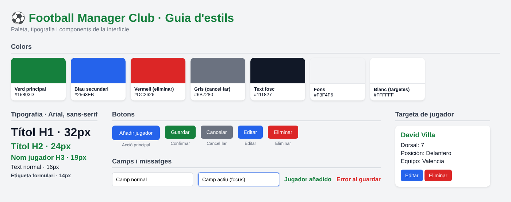

# Guia d'estils

## Nom del projecte

Football Manager Club

## Objectiu

Aplicació web per a la gestió de jugadors d'un club de futbol. La guia d'estils definix els colors, la tipografia i els components que s'utilitzen a tota la interfície perquè el disseny siga coherent.

---

## Colors

| Color | Codi | Ús |
|-------|------|----|
| Verd principal | `#15803D` | Capçalera, títols, nom dels jugadors, botó *Guardar*, missatges d'èxit |
| Blau secundari | `#2563EB` | Botó *Añadir jugador*, botó *Editar*, camp actiu del formulari |
| Vermell | `#DC2626` | Botó *Eliminar*, missatges d'error |
| Gris | `#6B7280` | Botó *Cancelar* |
| Text fosc | `#111827` | Text general |
| Gris clar | `#F3F4F6` | Fons de la pàgina |
| Blanc | `#FFFFFF` | Fons de les targetes i del formulari, text dels botons |

**Colors en estat hover** (en passar el ratolí per damunt, el botó s'enfosquix):

| Botó | Normal | Hover |
|------|--------|-------|
| Blau | `#2563EB` | `#1D4ED8` |
| Verd | `#15803D` | `#166534` |
| Vermell | `#DC2626` | `#B91C1C` |
| Gris | `#6B7280` | `#4B5563` |

El verd s'ha triat per la temàtica futbolística (color de la gespa). Cada acció té el seu color: blau per a crear o editar, verd per a confirmar, vermell per a eliminar i gris per a cancel·lar.

---

## Tipografia

- **Font:** Arial, sans-serif (llegible i disponible en tots els sistemes)

| Element | Mida | Estil |
|---------|------|-------|
| Títol principal (H1) | 32px | Negreta, blanc sobre verd |
| Títol del formulari (H2) | 24px | Negreta, verd |
| Nom del jugador (H3) | 19px | Negreta, verd |
| Text normal | 16px | Normal |
| Etiquetes del formulari | 14px | Negreta, gris fosc |

---

## Components

### Botons
- Sense vora, cantonades arrodonides (6–8px)
- Text blanc
- Efecte *hover*: el color s'enfosquix
- Cursor de mà (`cursor: pointer`)

### Targetes de jugador
- Fons blanc, cantonades arrodonides de 10px
- Ombra suau: `box-shadow: 0 2px 5px rgba(0,0,0,0.1)`
- Nom en verd i dades a sota
- Botons *Editar* i *Eliminar* al final

### Formulari
- Mateix estil que les targetes (fons blanc, ombra, 10px)
- Camps amb vora gris `#D1D5DB` i cantonades de 6px
- En seleccionar un camp, la vora es posa blava amb un halo suau
- La posició es tria amb un desplegable (*Portero*, *Defensa*, *Centrocampista*, *Delantero*)

### Missatges
- Èxit: text verd en negreta ("Jugador añadido")
- Error: text vermell en negreta ("Error al guardar")
- Desapareixen sols als 3 segons

---

## Espaiat

- Marge general de la pàgina: 20px
- Separació entre targetes: 15px
- Farciment intern de targetes: 15px; del formulari: 20px
- Amplada màxima del contingut: 1100px, centrat

---

## Disseny responsive

- Les targetes es col·loquen en una **graella** (`grid`) que s'adapta a l'amplada de la pantalla: 4 columnes en ordinador, 1 en mòbil.
- El formulari també usa graella i passa a una sola columna en pantalles estretes.
- En pantalles de menys de **600px**, el botó *Añadir jugador* ocupa tota l'amplada i es reduïxen els marges.
