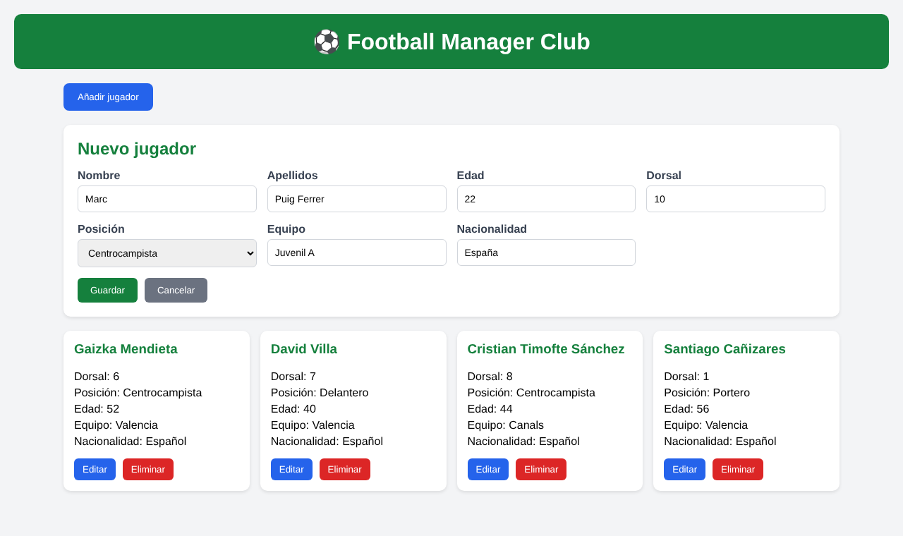
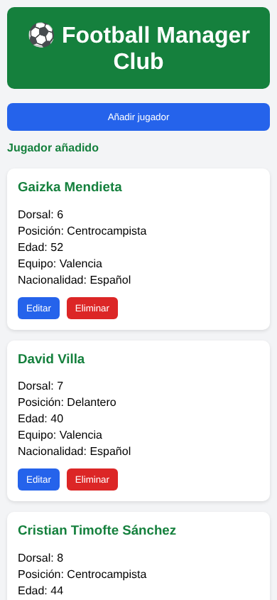

# Prototipat

El prototipat s'ha fet en dues fases:

1. **Wireframe (baixa fidelitat):** esquema de les pantalles per a decidir l'estructura i els elements abans de programar.
2. **Prototip d'alta fidelitat:** disseny final amb els colors, la tipografia i els components de la [guia d'estils](guia-estils.md).

---

## 1. Wireframe (baixa fidelitat)

### Pantalla principal

```
+------------------------------------------------------------+
|                 ⚽ FOOTBALL MANAGER CLUB                    |
+------------------------------------------------------------+

  [ Añadir jugador ]

  Jugador añadido                       <- missatge (3 s)

  +----------------+ +----------------+ +----------------+
  | Nom Cognoms    | | Nom Cognoms    | | Nom Cognoms    |
  | Dorsal: 10     | | Dorsal: 1      | | Dorsal: 5      |
  | Posició: ...   | | Posició: ...   | | Posició: ...   |
  | Edat: ...      | | Edat: ...      | | Edat: ...      |
  | Equip: ...     | | Equip: ...     | | Equip: ...     |
  | Nacionalitat   | | Nacionalitat   | | Nacionalitat   |
  |[Editar][Elim.] | |[Editar][Elim.] | |[Editar][Elim.] |
  +----------------+ +----------------+ +----------------+
```

### Formulari d'afegir / editar jugador

S'obri en prémer *Añadir jugador* (buit) o *Editar* (amb les dades del jugador).

```
+------------------------------------------------------------+
| Nuevo jugador  /  Editar jugador                           |
|                                                            |
| Nom*            Cognoms*        Edat          Dorsal*      |
| [__________]    [__________]    [____]        [____]       |
|                                                            |
| Posició*        Equip           Nacionalitat               |
| [Portero ▼]     [__________]    [__________]               |
|                                                            |
| [ Guardar ]  [ Cancelar ]                                  |
+------------------------------------------------------------+
  * camp obligatori
```

### Versió mòbil

```
+----------------------+
|  ⚽ FOOTBALL MANAGER  |
|        CLUB          |
+----------------------+
| [   Añadir jugador  ]|
|                      |
| +------------------+ |
| | Nom Cognoms      | |
| | Dorsal / Posició | |
| | [Editar][Elim.]  | |
| +------------------+ |
| +------------------+ |
| | Nom Cognoms      | |
| | ...              | |
+----------------------+
```

---

## 2. Prototip d'alta fidelitat

### Escriptori: llista de jugadors i formulari obert



### Mòbil



---

## Flux de l'usuari

```
Obrir la web
   │
   ▼
Llista de jugadors (es carrega de MongoDB)
   │
   ├── [Añadir jugador] ──► Formulari buit ──► [Guardar] ──► POST /api/players ──► Llista actualitzada
   │                                       └─► [Cancelar] ──► Es tanca el formulari
   │
   ├── [Editar] ──► Formulari amb les dades ──► [Guardar] ──► PUT /api/players/:id ──► Llista actualitzada
   │
   └── [Eliminar] ──► Confirmació "¿Seguro...?" ──► [Aceptar] ──► DELETE /api/players/:id ──► Llista actualitzada
```

## Decisions de disseny

- **Una sola pantalla:** tot es fa des de la mateixa pàgina, sense canviar de vista, perquè la gestió siga ràpida.
- **Formulari ocult:** només apareix quan cal, així la llista de jugadors és el centre de la pantalla.
- **Targetes:** cada jugador es mostra com una fitxa, semblant als cromos de futbol, fàcil de llegir d'un colp d'ull.
- **Confirmació en eliminar:** evita esborrar un jugador per error.
- **Desplegable per a la posició:** evita errors d'escriptura i garantix que només s'usen valors vàlids.
